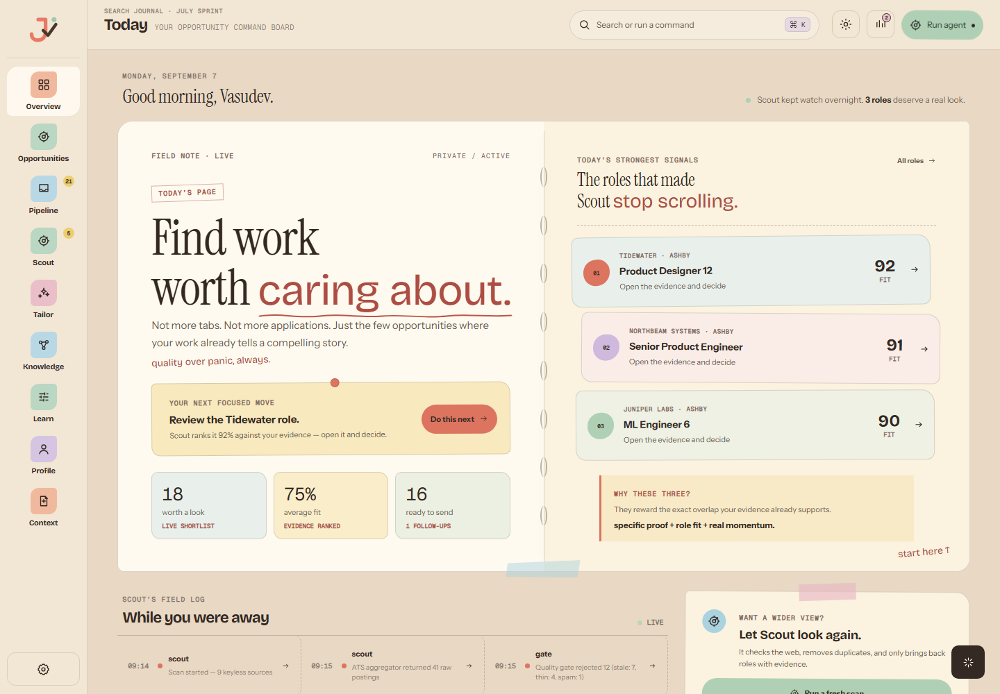
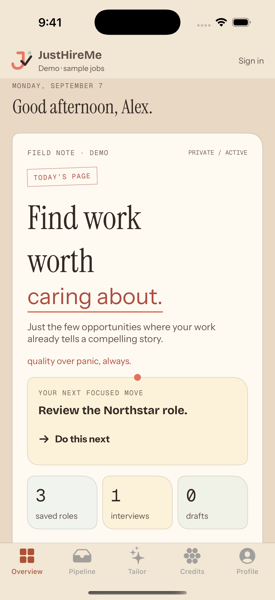
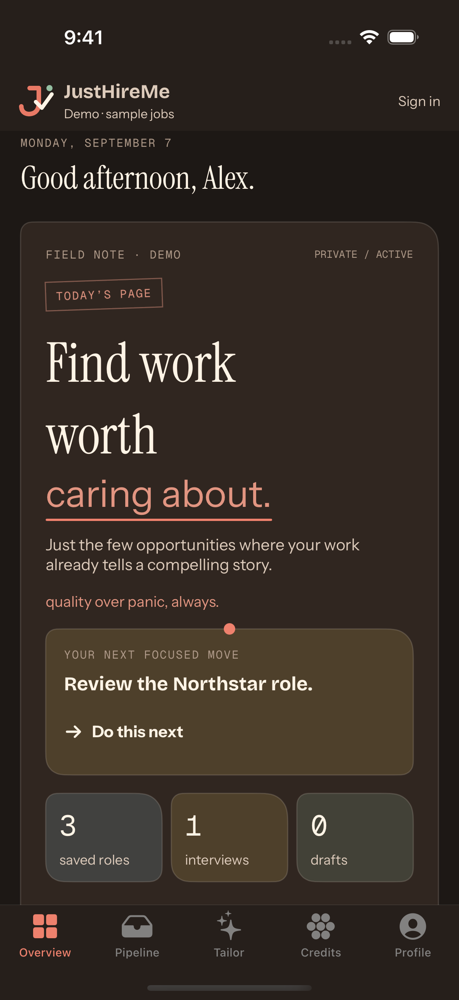
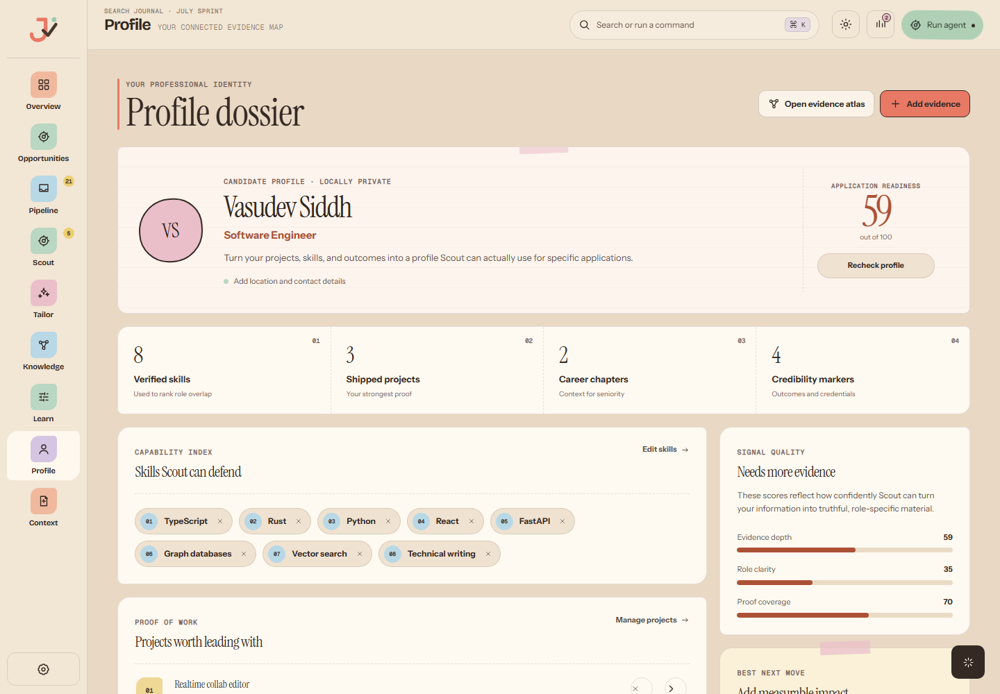
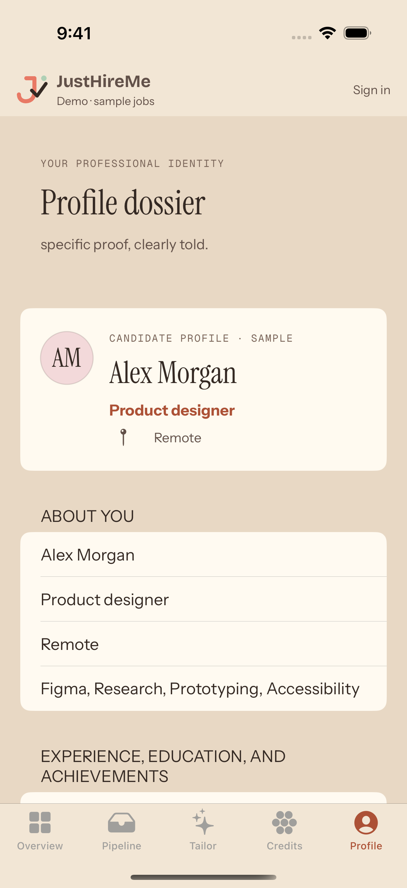
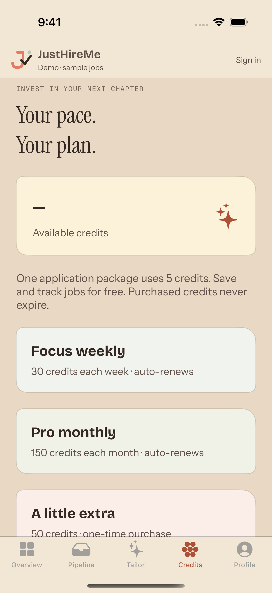
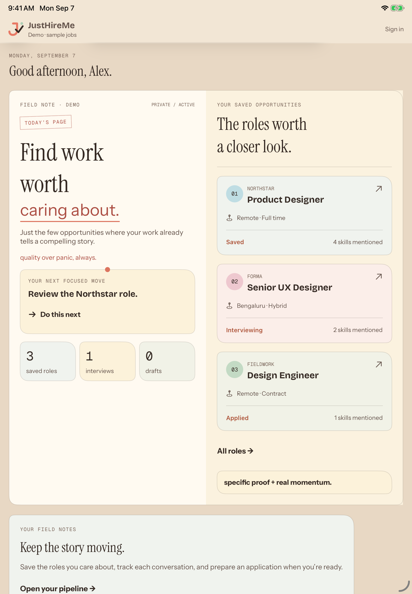

# Desktop journal design on iOS

Reference: the v1.7.0 desktop frontend at `be58edc`, used by the Windows build. The local `justhireme.exe` reports product/file version 1.7.0. The production `DashboardView.tsx`, `production-journal.css`, `demo/atelier.css`, and `justhireme-mark.svg` define the design. The real React views were rendered with the existing development preview harness and synthetic data, in light and dark mode. The Windows executable itself was not automated.

## Shared visual identity

- Same Instrument Serif editorial headings, Instrument Sans body, Bricolage Grotesque functional headings, and Geist Mono captions/numerals. The actual desktop TTF files are bundled locally with their OFL licenses. Native tests assert they register successfully.
- All six bundled TTF files were compared byte-for-byte with their desktop sources and matched.
- Same desktop mark paths, including the coral J, check, and green dot. The app icon is rendered from the same desktop SVG.
- Light desk `#e8d8c4`, chrome `#f2e6d5`, card `#fffaf1`, ink `#342923`, accent `#ac5136`; dark desk `#1d1815`, chrome `#261f1b`, card `#302620`, ink `#fff4e6`, accent `#ee816d`.
- Today's page stamp, “Find work worth caring about.” headline, a pinned next-action note, pastel metrics, numbered role cards, and asymmetric paper corners.
- Overview, Pipeline, Tailor, and Profile follow the desktop's naming and visual hierarchy. Credits uses the same cards for mobile billing.

## Platform adaptations

The iPhone uses native bottom tabs and stacks the journal pages vertically; regular-width iPad screens put the pages alongside one another. Touch controls, text sizing, search, forms, and sheets retain native behavior. Font sizes scale with Dynamic Type using [Apple's custom font API](https://developer.apple.com/documentation/swiftui/font/custom(_:size:relativeTo:)).

This is visual alignment, not desktop feature parity. The cloud/mobile app still tracks manually saved roles and drafts. It does not claim Scout is scanning, invent fit scores, or display desktop graph/ranking data it does not have. Metrics show actual saved roles, interviews, and drafts. The demo is explicitly labelled and does not purchase credits or call AI.

## Verification

The CI workflow builds on a hosted Mac, checks bundled fonts, runs the existing job tracking and account/demo tests, tests dark-mode navigation and accessibility text sizing, and exports screenshots. It also installs and captures the app on an available iPad. See [the validation record](IOS_VALIDATION.md) for completed runs and remaining release gates.

## Captured comparison

Desktop reference, light theme (real production React views with preview data):

iPhone simulator, light and dark themes, from native test run `34138397456`:

| Light | Dark |
| --- | --- |
|  |  |

Desktop Profile reference:

| iPhone Profile | Mobile credit plans |
| --- | --- |
|  |  |

Additional captures: [desktop dark theme](mobile-ui/desktop-dark.png), [mobile Pipeline dark theme](mobile-ui/ios-pipeline-dark.png), [accessibility text size](mobile-ui/ios-large-text.png). These are actual captures, not generated mockups. Native layout differs with screen width and text size; this is design alignment rather than pixel-for-pixel desktop replication.

iPad (10th generation), iOS 26.2, from [tablet capture run 34139482938](https://github.com/vasu-devs/JustHireMe-iOS-private/actions/runs/34139482938), using the identical tested app archive:

