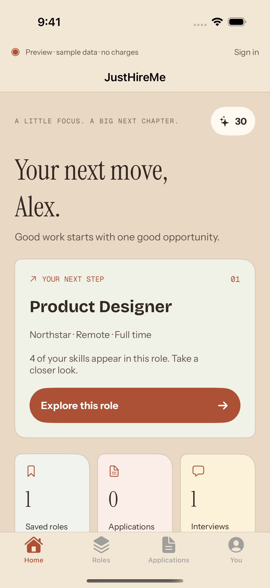
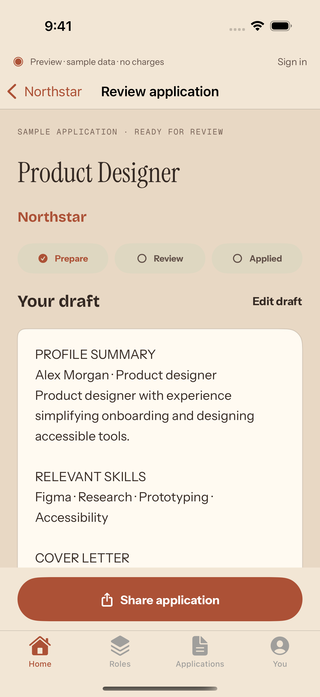
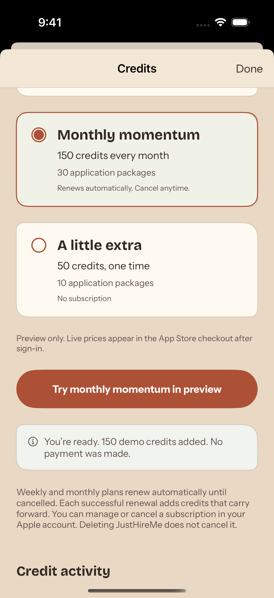
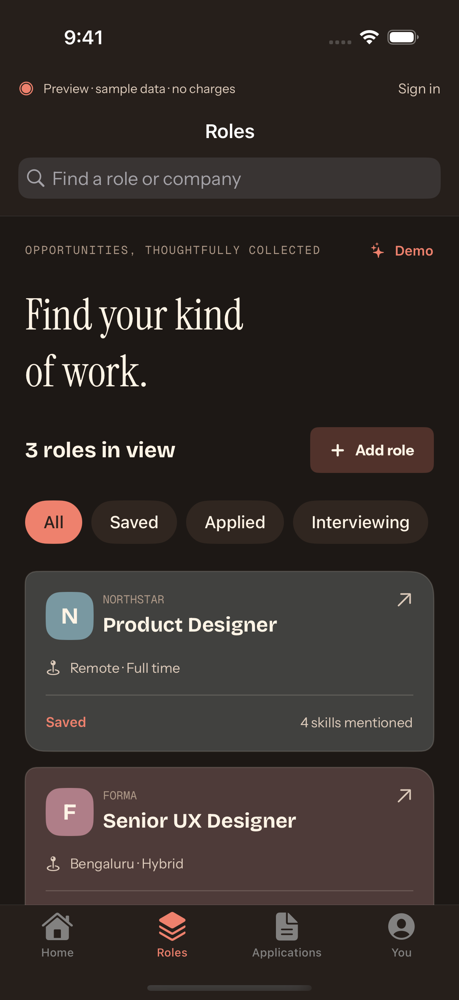
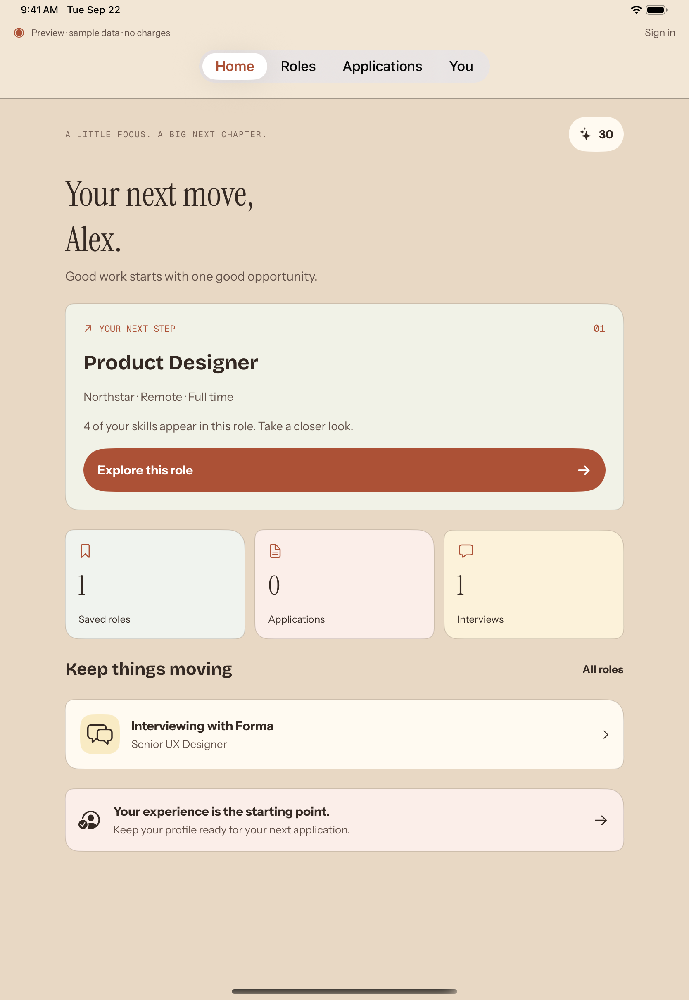

# JustHireMe — consumer frontend review

Historical review. See the [current pastel notebook screenshots and recording](IOS_NOTEBOOK_REVIEW.md) for the replacement requested on 22 September.

A focused iOS workspace for a paying customer, using the same warm palette and typography as the desktop app.

[Watch the 47-second simulator walkthrough](mobile-ui/consumer/walkthrough.mp4)

The clip follows Home → role details → sample application → applied status → Applications → Roles → profile → monthly-plan preview. This is native simulator footage, trimmed to remove the test-launch lead-in and exit and resized for easy playback. It contains fictional sample data and no real purchases or AI requests.

## Verified build

App source: `3568650`. [Private CI run](https://github.com/vasu-devs/JustHireMe-iOS-private/actions/runs/35712323818).

- Nine model tests, five UI scenarios, and one recorded walkthrough passed.
- Xcode 26.3; iPhone 16 Pro simulator on iOS 18.5.
- iPad installation and layout capture completed.
- Dark mode and accessibility text size checked.
- Unchanged backend regression suite: 29 tests passed on SQLite and PostgreSQL.

## Home

## Application review

## Plans and credits

## Dark mode

## iPad

Live authentication, AI generation, Apple sandbox billing, device signing, and TestFlight are separate integration/release steps. See the [frontend handoff](IOS_FRONTEND_HANDOFF.md) for the current contracts and device-local draft storage.
