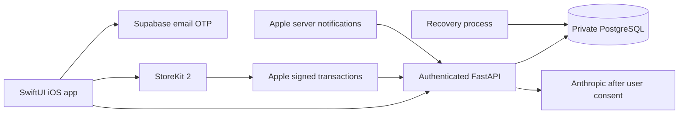

# JustHireMe iOS launch plan

Prepared 7 September 2026. Implementation entry points: [iOS](../ios/README.md), [cloud API](../cloud/README.md). This document distinguishes available code from deployment and App Store work that needs real accounts and macOS validation.

## Product and pricing

The mobile launch scope is a focused job-search workspace: save job descriptions, track applications, maintain a professional profile, prepare AI application drafts, and share drafts after review. It does not promise automatic job discovery, guaranteed placement, automated applications, or the desktop's full graph/vector pipeline.

Recommended starting catalog (commercial proposal, not published prices):

| Offer | Proposed US price | Delivery | Approximate application packages |
| --- | ---: | --- | ---: |
| Focus weekly | $3.99/week | 30 credits per paid renewal | 6 |
| Pro monthly | $12.99/month | 150 credits per paid renewal | 30 |
| Extra credits | $5.99 once | 50 credits | 10 |

Choose final price points and storefront availability in App Store Connect after measuring provider cost. The app displays StoreKit's localized price rather than hardcoded dollar amounts. Configure weekly and monthly products in one subscription group at the same service level, so users can switch billing cadence without intentionally holding two subscriptions. Disable Family Sharing. No trial, introductory offer, weekly one-time pass, or annual plan is currently configured.

The weekly offer is an auto-renewing weekly subscription, not a pack that disappears after seven days. All purchased credits carry forward. Apple prohibits expiry of purchased credits and requires in-app purchase for these digital features under its standard rules. [App Review Guidelines, 3.1.1–3.1.2](https://developer.apple.com/app-store/review/guidelines/#in-app-purchase), [subscriptions](https://developer.apple.com/app-store/subscriptions/).

Use this break-even calculation before setting prices: net receipts per pack = gross price − applicable store commission − applicable tax deductions; contribution = net receipts − worst-case AI cost for all included credits − allocated hosting/support/refund cost. Measure long-profile input tokens, output tokens, retries, failure refunds, and retained storage. Set an internal spend cap and test that 5 credits covers a package at your chosen provider/model. Do not assume every account consumes only a fraction of its credits.

## Architecture

The desktop remains a separate local product. Do not deploy its unauthenticated local API as the SaaS server. There is no automatic synchronization of desktop profiles into the cloud. Mobile customers create cloud profiles explicitly and consent before AI drafting. Technical storage, isolation, recovery, and retention details are in the cloud README.

## Apple account and app setup

1. Enroll the correct individual or organization in the Apple Developer Program. Apple currently lists USD 99 per year, with local pricing and eligibility variations. An organization's seller identity requires its enrollment details; an individual enrollment uses the person's legal name. [Enrollment](https://developer.apple.com/programs/enroll/).
2. Register a unique explicit App ID. The code's proposed identifier is `com.justhireme.mobile`; replace it consistently if unavailable. Add the app record in App Store Connect, set the signing team in Xcode, and record the numeric App Store app ID for server verification.
3. Complete the Paid Apps agreement, banking and tax details using the owner's real information. Create the exact three product IDs from the cloud README, localizations, subscription group, price points, review screenshots, and availability. Do not enable offers or family sharing without corresponding server/client tests.
4. Build with Xcode 26 or later and an iOS 26 SDK. Apple has required these for submissions since 28 April 2026; supporting iOS 17 as the minimum OS is a separate setting. [Current SDK requirements](https://developer.apple.com/news/upcoming-requirements/).
5. Create production/staging cloud deployments and review-access accounts. Store secrets in the host's secret manager. Put only HTTPS URLs and the public Supabase key in `Configuration.plist`. Publish real privacy/support pages and confirm every link in the app works.
6. Configure Apple root certificates and Notifications V2. In production, allowlist only the designated review account IDs for sandbox verification. Reviewers must be able to reach a real backend and retrieve email OTP codes through a documented review mailbox workflow. Test that workflow from a clean device; the demo alone does not exercise account features.

## Verification before upload

- Run the cloud tests on PostgreSQL and the native Xcode build/tests. A Windows structural check is not native compilation. Verify the app on an iPhone and iPad, light/dark themes, large text, VoiceOver, poor networking, expired sessions, and sign-out during a request.
- Exercise sign-up, OTP resend/expiry, session refresh, logout, profile persistence, consent off/on, job save/status changes, draft generation, duplicate taps, insufficient credits, provider failure, request timeout/recovery, and export. Verify account A never sees account B's data.
- Use real StoreKit sandbox testing with Apple-signed transactions. Local Xcode StoreKit test signatures are deliberately not accepted by the production verifier. Test weekly/monthly renewal, switching plans, cancellation, expiration, pending approval, interrupted purchase, reinstall/restore, refund, refund reversal, repeated/out-of-order notifications, account mismatch, and billing retry. Confirm each paid transaction changes the ledger once.
- Configure and verify the included hourly App Store Server API history reconciliation before a public paid launch. It replays known customers' transactions and the previous 30 days of notification history, including first purchases missed during outages. Test pagination, failure alerts, refund reversals, and catch-up using real Apple sandbox records. Larger volumes require an incremental/backfill strategy beyond the bounded launch implementation.
- Confirm deletion removes account content and auth, remains retryable after a partial outage, and does not cancel Apple subscriptions silently. Set the retention period and validate the included recovery/purge process for minimal financial records. Account deletion is offered in the app as required by Apple. [Deletion guidance](https://developer.apple.com/support/offering-account-deletion-in-your-app/).
- Complete HTTPS ingress rate limits, provider quotas, non-sensitive operational alerts, backups, and a restore drill. Establish actual data/backup retention and publish it. Document exactly what Anthropic receives and obtain consent before sharing personal data with third-party AI. [Privacy and AI disclosure rules](https://developer.apple.com/app-store/review/guidelines/#privacy).
- Confirm distribution rights against this repo's existing [commercial licensing](../COMMERCIAL_LICENSE.md) and contributor agreements before choosing the App Store distribution terms. No repository license has been changed by this implementation.

## Store listing draft

**Name:** JustHireMe

**Subtitle:** Your job search, in focus

**Description:** Keep your next career move organized. Save promising roles, track applications and interviews, and turn your own experience into tailored résumé, cover letter, and outreach drafts. Review and share applications on your terms. Start with free job tracking, then choose a weekly plan, monthly plan, or extra credits when you need help preparing applications. Purchased credits carry forward. AI drafting is optional and requires your permission to share your profile and job description with our AI provider.

**Keywords:** job search,resume,cover letter,career,applications,interview,job tracker

**Subscription disclosure:** Weekly and monthly plans renew automatically unless cancelled through your Apple account. Payment and renewal terms are shown before purchase. Purchased credits do not expire. Deleting the app or your JustHireMe account does not cancel an Apple subscription.

Supply real screenshots captured from the built app on Apple's required device sizes. Capture an empty account, populated workspace, job detail, profile consent, draft review, and the actual localized paywall. Use fictional screenshot content and remove names/emails from debugging captures. No simulator screenshot or marketing image has been generated in this Windows session.

Complete the age-rating questionnaire, export-compliance questions based on actual cryptography use, support URL, privacy policy URL, and App Privacy labels. Expected collected categories include name, email, user ID, purchase history, and user-provided résumé/profile/job content linked to the account for app functionality. Free-text location or other résumé fields may require additional data categories; assess the actual shipped inputs and provider practices. The included privacy manifest is a starting declaration, not an automatic replacement for App Store Connect privacy answers. [App privacy details](https://developer.apple.com/app-store/app-privacy-details/).

## TestFlight and release

Archive the signed Release scheme in Xcode and validate it in Organizer. Resolve all App Store validation warnings, including icon opacity and privacy metadata. Upload to App Store Connect, distribute first to internal TestFlight testers, and complete the lifecycle tests above against staging. Then invite external testers through TestFlight review. Resolve failures before selecting the production build and its in-app purchases for App Review.

Give reviewers working login instructions, the review account mailbox/code retrieval procedure, steps to add a sample job and test a draft, the credit pricing, and an explanation that AI creates drafts for user review rather than applying to employers automatically. Set manual release so approval does not publish the app unexpectedly. After review approval and the owner's release decision, release gradually and monitor errors, billing deliveries, and support reports.

## What remains outside this workspace

No Mac, Apple developer credentials, signing identity, live Supabase project, SMTP service, paid AI credentials, App Store product records, or hosting account were available to configure. Native build/UI verification, production deployment, real payment testing, configuring and validating reconciliation/retention operations, and submission remain incomplete. These are concrete launch gates; the repository changes are not evidence of an approved or deployed app.
