# Pastel notebook frontend — 22 September 2026

The subsequent [typography and copy refinement](IOS_NOTEBOOK_TYPOGRAPHY.md) has the current screenshots. The recording and screenshots below show the initial pastel version, before that refinement.

The revised native app has five customer sections: **Profile, For You, Applications, Grow, Plan**. Lavender, mint, peach and sky-blue cards sit on ruled paper, with pencil borders, crayon underlines and textbook-style headings. The desktop profile dossier inspired the editable notebook sections.

[Watch the 40-second native simulator walkthrough](mobile-ui/notebook/walkthrough.mp4)

The recording follows profile → organized Markdown import → recommendations → Apply now → application timeline/chart → learning suggestions → application plans. It is actual footage from the tested SwiftUI app, losslessly trimmed at a keyframe and preserved at its original 1206 × 2622 resolution. It uses fictional preview data; no employers are contacted and no purchases are made.

## Verified scope

[Private CI run](https://github.com/vasu-devs/JustHireMe-iOS-private/actions/runs/35715587730), app revision `da091d3d9c74d4d3be83e1dc98190f88592fa140`: **15 model tests + five UI scenarios + one recorded walkthrough passed**. The iPad launch and layout capture also succeeded. Dark mode and one accessibility text size were exercised; these are not a complete accessibility or device matrix.

The frontend supports reviewed local text extraction, editable profile chapters, preview application submission and status changes, bounded auto-apply, learning progress, and application allowance selection. Profile content is session-only and can be exported as Markdown. AI ingestion/OCR, user storage, global job recommendations, actual submissions/outcomes and live billing are still backend work. See [the handoff](IOS_NOTEBOOK_HANDOFF.md) for proposed contracts and boundaries.

## Profile and content

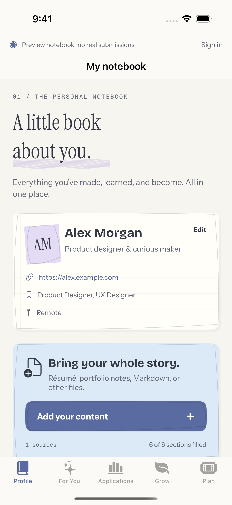

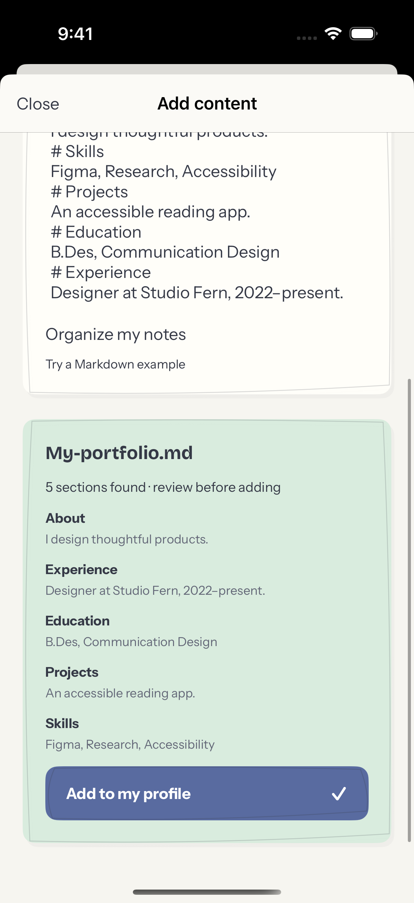

## Recommendations and application outcomes

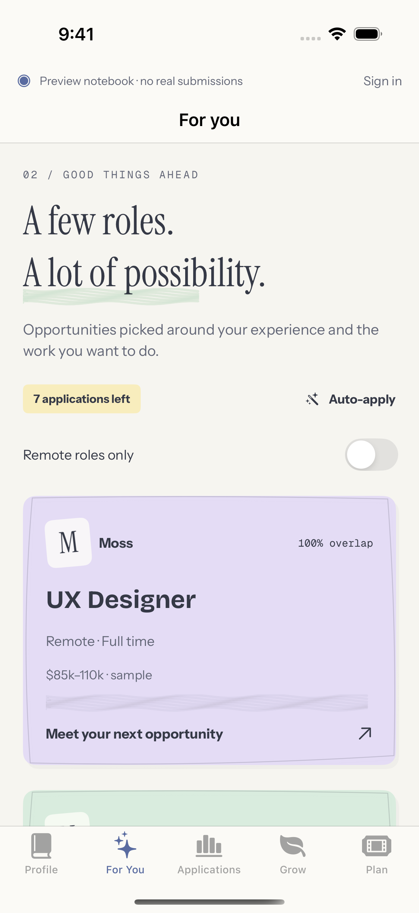

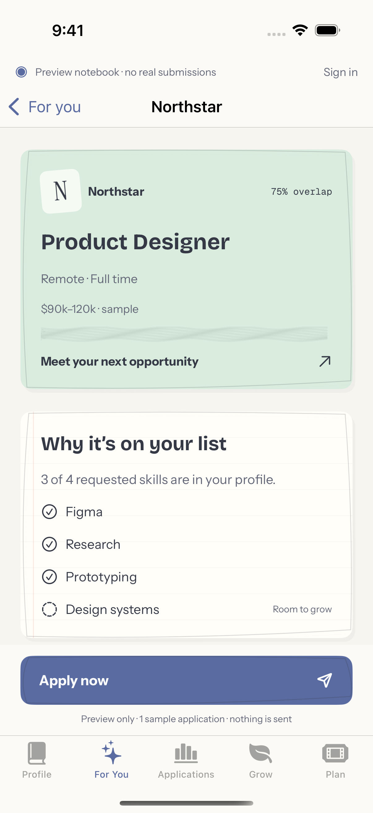

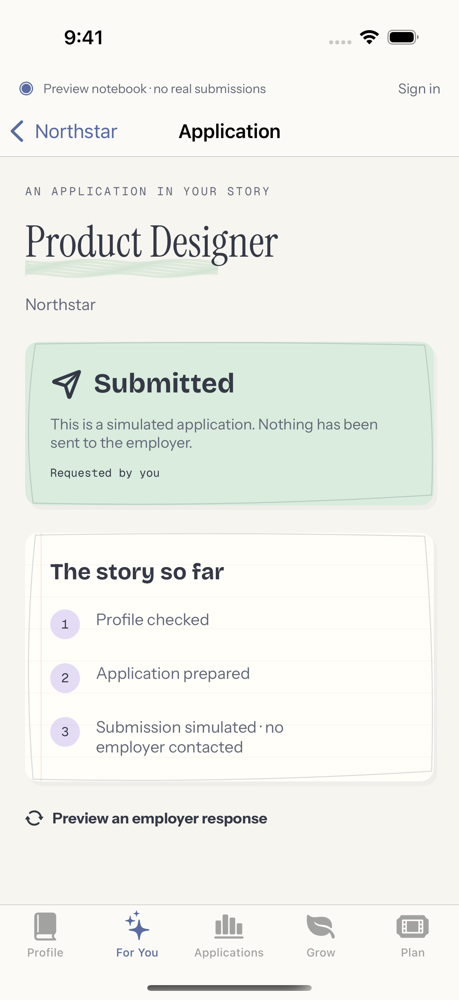

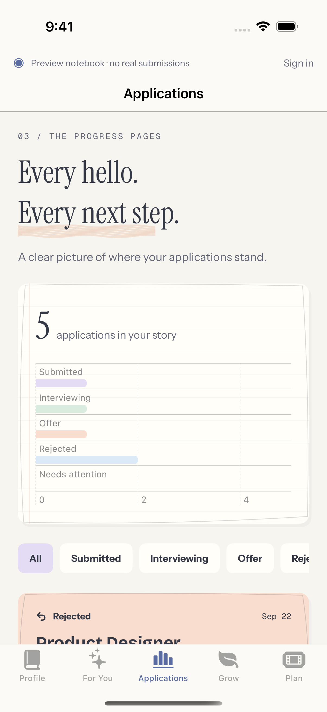

## Application plans and automation

The sample choices are one application, ten per week, and forty per month. Quantities are proposals; final products/prices require App Store configuration. Auto-apply preview uses the same allowance and requires opt-in, role/location boundaries, a minimum skill overlap and a daily cap.

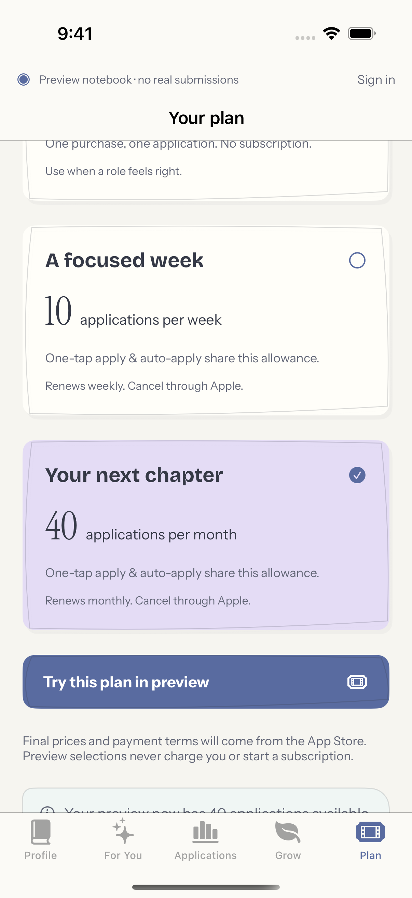

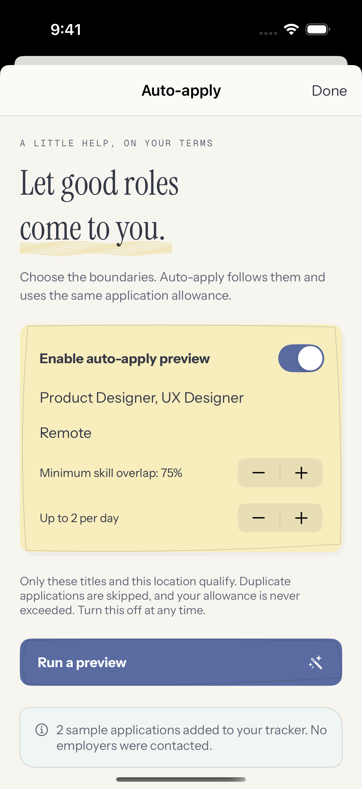

## Growth, dark mode and larger layouts

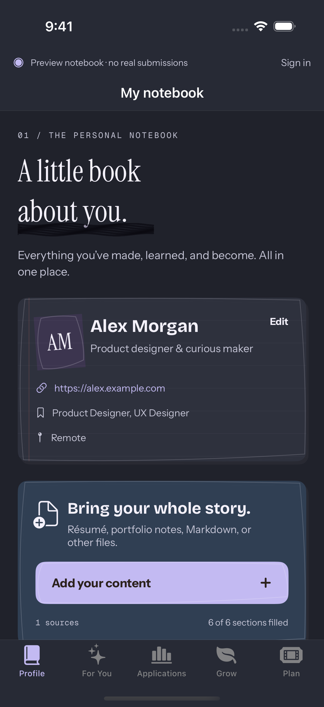

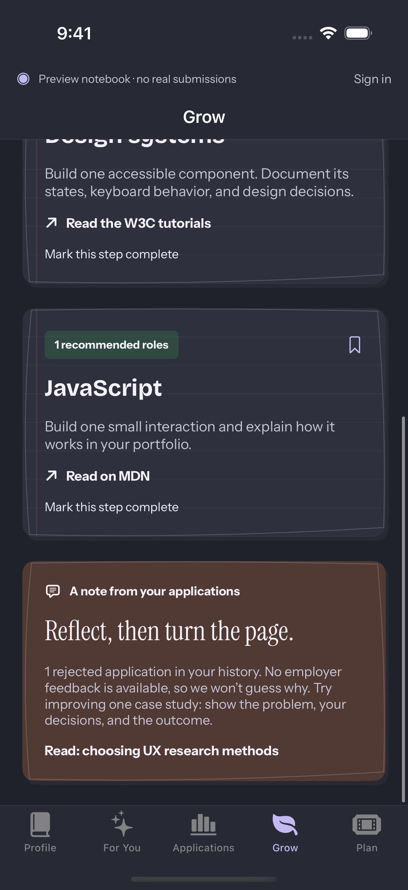

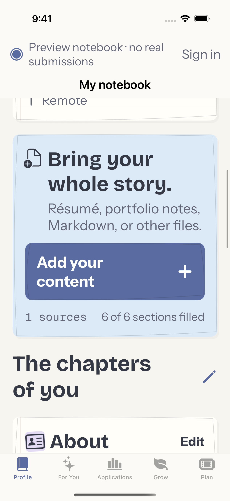

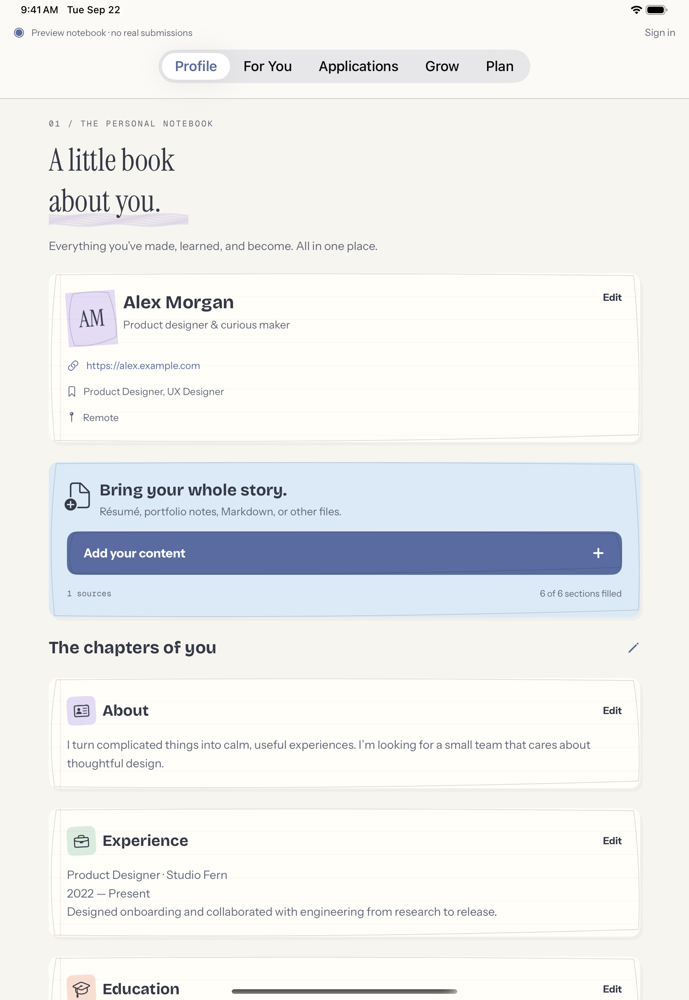
