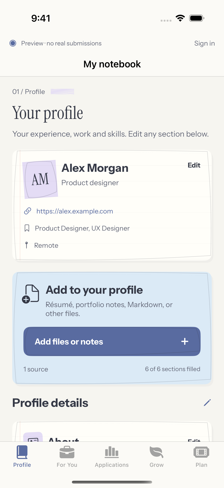
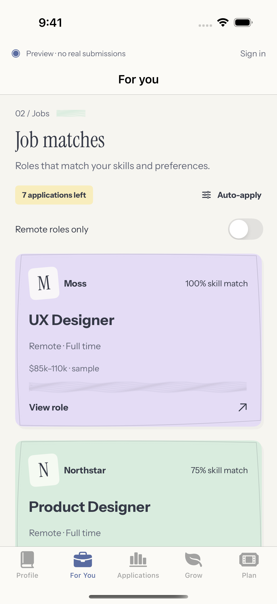
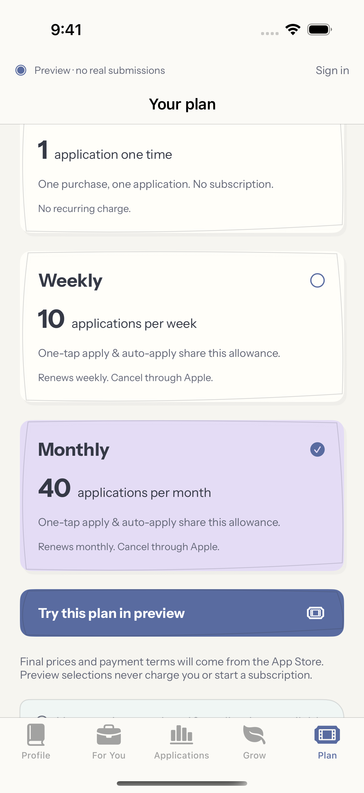
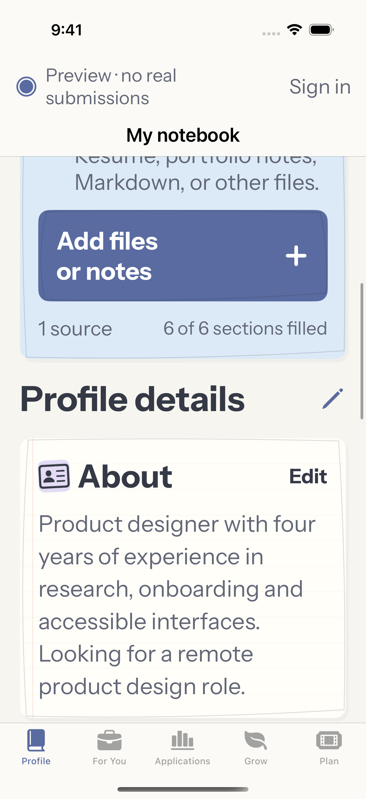

# Notebook typography refinement

The pastel paper design remains, with smaller headings, less decorative copy and a clearer hierarchy. Main page headings now use a 32-point serif instead of oversized two-line slogans. Instrument Sans handles body text and section headings; the navigation title is smaller, and crayon marks sit beside the page label instead of crossing the title.

The five pages use direct titles: Your profile, Job matches, Your applications, What to work on, and Application plans. Buttons say what they do, such as View role and Export profile. Plans are named Single application, Weekly and Monthly. The profile source count and learning tags handle singular/plural correctly. Sample profile text is also more concrete.

The application behavior and preview boundaries are unchanged. Sign-in copy now accurately says that profile sync and live submissions are not connected.

Native validation: [run 35718554854](https://github.com/vasu-devs/JustHireMe-iOS-private/actions/runs/35718554854), app revision `2143539f215820d5e1b389f45467fc4469de82c2`. All 21 native checks passed: 15 model tests, five UI scenarios and the recorded walkthrough. The same build launched and captured successfully on iPad. The unchanged backend passed its 29 tests against SQLite and again against PostgreSQL. No new tests were added for this visual change; the existing outcome assertion was updated for the new label.

